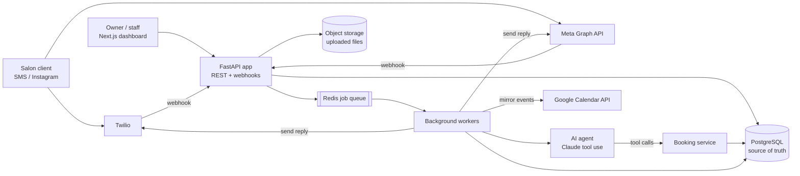
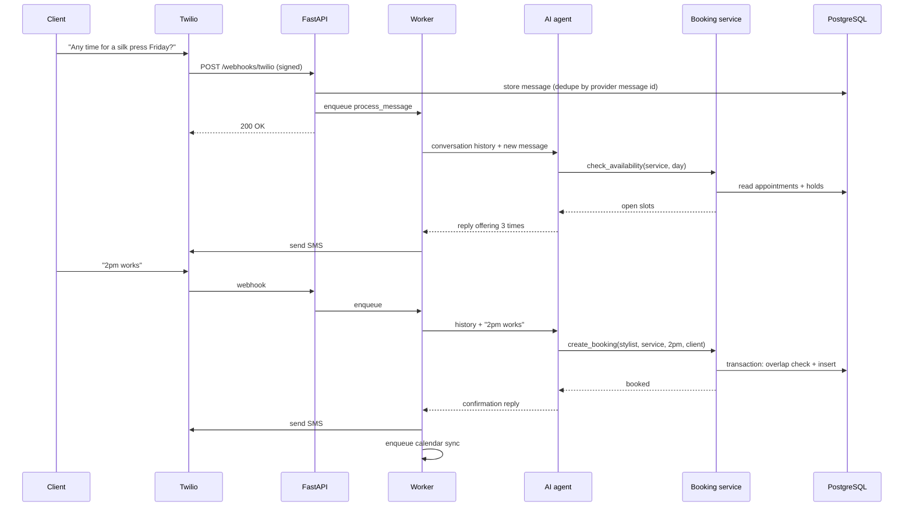
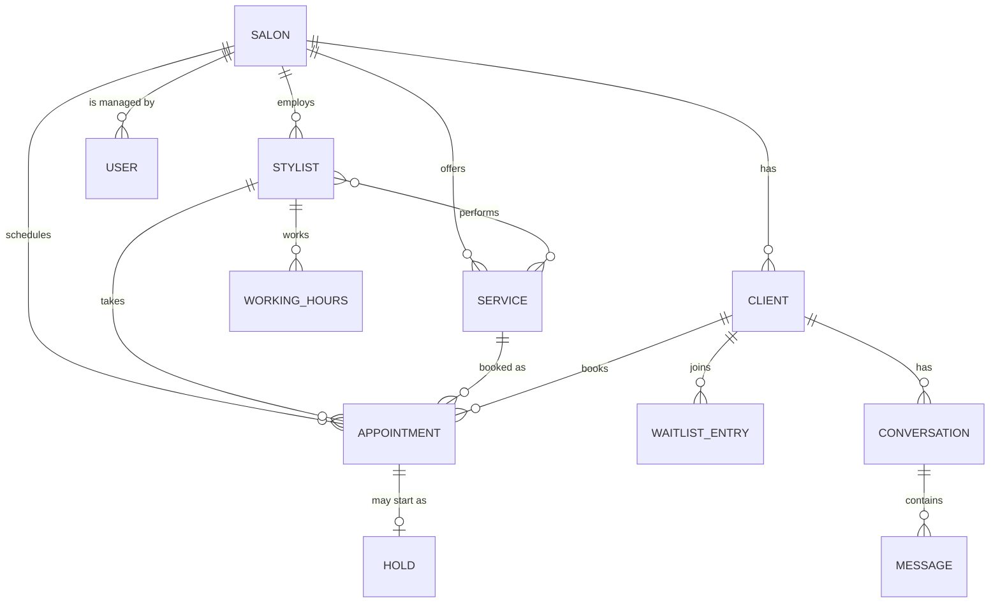
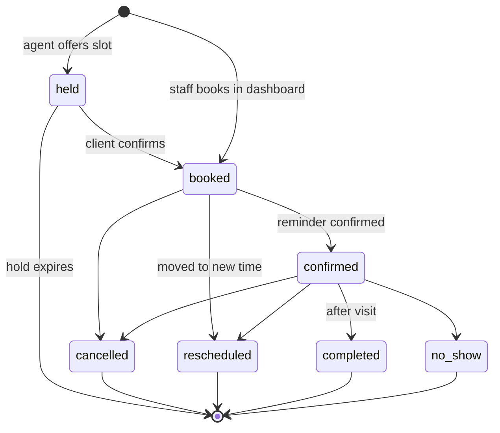

# FullChair: System Design

Nov 3, 2026 · @maryam

## 1. Overview

FullChair is an AI front desk for salons. It answers clients over SMS and Instagram DMs, books, cancels, and reschedules appointments on its own, refills cancelled slots from a waitlist, and keeps the salon's Google Calendar in sync. Salon owners manage everything from a web dashboard.

**Problem.** Salon staff are usually busy with clients and miss messages. Every unanswered "do you have anything Friday?" is a lost booking, and every last-minute cancellation is an empty chair. FullChair responds instantly, books only times that are actually free, and fills cancellations automatically.

**Users.**

| Actor | What they do |
| --- | --- |
| Salon owner / admin | Connects channels, configures salons, stylists, services, and hours; views the calendar |
| Stylist | Views their own schedule |
| Client | Messages the salon by SMS or Instagram to book, cancel, or reschedule |
| AI agent | Interprets messages, checks availability, and calls booking actions through tools |

**Design principles.**

- **The database is the source of truth.** Google Calendar is a mirror, never the authority, so a calendar sync failure can't cause a double booking.
- **The AI never writes to the database directly.** It calls typed tools that go through the same validated booking service as the dashboard.
- **Confirm before committing.** The agent offers times, places a short hold, and books only after the client confirms.
- **Every query is scoped to a salon** (multi-tenant from day one).

## 2. Requirements

### Functional

1. **Connect channels.** An owner signs in and connects SMS (Twilio), Instagram (Meta), and Google Calendar through OAuth.
2. **Configure the salon.** Add salons, stylists, services (duration, price), and working hours, either manually or by uploading a file (CSV, PDF, image of a menu) that the AI turns into a draft configuration for the owner to review.
3. **Book by message.** A client asks for an appointment; the agent finds open slots for the right stylist and service, offers a few, places a hold, and books once the client confirms.
4. **Cancel.** By message ("cancel my Friday appointment") or from the dashboard. The freed slot is offered to waitlisted clients.
5. **Reschedule.** By message or dashboard; this is an atomic cancel-and-book, so the client never loses their old slot if the new one fails.
6. **Waitlist.** Clients can join a waitlist for a service and time window; a cancellation triggers offers in order.
7. **Book manually.** Staff can create, edit, and cancel appointments from the dashboard (pick salon, service, stylist, time, client name and phone).
8. **Calendar view.** Day and week views of upcoming appointments per stylist.
9. **Calendar sync.** Every appointment change is mirrored to Google Calendar.
10. **Human handoff.** When the agent is unsure, it hands the conversation to staff with a summary.

### Non-functional

| Property | Target |
| --- | --- |
| Correctness | **Zero double bookings**, even with concurrent requests |
| Reply latency | First reply to a client within about 5 seconds (p95) |
| Availability | 99.9% for messaging and booking; the dashboard can tolerate brief downtime |
| Durability | No lost inbound messages; webhooks are acknowledged only after being stored |
| Consistency | Strong consistency for bookings; eventual consistency (seconds) for Google Calendar |
| Security and privacy | Encrypted OAuth tokens, client phone numbers treated as PII, strict per-salon isolation |
| Compliance | Honor SMS opt-out keywords (STOP, HELP) and consent rules |

### Out of scope (v1)

Payments and deposits, multi-location chains with shared staff, voice calls, a client-facing mobile app, and two-way sync where edits made in Google Calendar flow back into FullChair.

## 3. Capacity estimates

Back-of-the-envelope numbers for a target of **1,000 salons**. All inputs are assumptions, chosen to size the system, not measured data.

| Input (assumed) | Value |
| --- | --- |
| Salons | 1,000 |
| Stylists per salon | 5 |
| Appointments per stylist per day | 8 |
| Messages per booking conversation | about 6 (in + out) |
| Share of bookings made by message | 50% |

| Derived | Calculation | Result |
| --- | --- | --- |
| Appointments per day | 1,000 × 5 × 8 | 40,000 |
| Messages per day | 20,000 conversations × 6 | about 120,000 |
| Average message rate | 120,000 / 86,400 s | about 1.4 per second |
| Peak message rate | about 10× average, concentrated in business hours | about 15 per second |
| AI model calls per day | about 2 per inbound message | about 120,000 |
| Appointment storage per year | 40,000 × 365 × about 500 bytes | about 7 GB |
| Message storage per year | 120,000 × 365 × about 1 KB | about 45 GB |

**Takeaways.** Traffic is small; a single PostgreSQL primary with a read replica handles it easily. The real constraints are **AI model latency and cost** (each reply waits on one or more model calls), **correctness under concurrency** (two clients wanting the same slot), and **reliable delivery** of webhooks to and from third parties. The design optimizes for those rather than raw throughput.

## 4. High-level architecture



**How a message moves.** A webhook arrives, the API stores the message and enqueues a job, and returns 200 right away (third parties retry slow webhooks). A worker loads the conversation, runs the AI agent, and the agent acts only through tools that call the booking service. The reply goes back out through the same channel, and any appointment change triggers a calendar-sync job.

### Components

| Component | Responsibility | Why it's separate |
| --- | --- | --- |
| **FastAPI app** | REST API for the dashboard, inbound webhooks, auth | Stateless; scale horizontally behind a load balancer |
| **Booking service** (module) | Availability, holds, create, cancel, reschedule, all in database transactions | One place enforces the no-double-booking rule for both humans and the AI |
| **AI agent** | Turns a conversation into tool calls and a reply | Isolated so model changes, prompts, and costs don't touch booking logic |
| **Channel adapters** | Twilio and Meta send/receive behind one `MessagingChannel` interface | Add WhatsApp later without touching the agent |
| **Background workers** | Agent runs, outbound messages, waitlist offers, calendar sync, hold expiry, file imports | Slow or retry-prone work stays off the request path |
| **Redis** | Job queue (e.g. RQ or Celery) and short-lived locks | Decouples webhooks from slow AI calls |
| **PostgreSQL** | Salons, staff, appointments, conversations, waitlist | Transactions and constraints are essential for correctness |
| **Object storage** | Uploaded CSVs, PDFs, and menu images for AI configuration | Large files don't belong in the database |
| **Next.js dashboard** | Appointments, Configure, AI Import, and Calendar tabs | Separate deploy from the API |

In v1, the API, booking service, and agent can live in one FastAPI codebase (a modular monolith) with workers as a second process. The boundaries above are module boundaries first, so any of them can be split into its own service later if scale demands it.

## 5. Core flows

### 5.1 Booking by message



The agent places a **hold** on the offered slots (about 10 minutes) so another client can't take them mid-conversation. Holds expire automatically.

### 5.2 Cancellation with waitlist backfill

Your original design used the keyword "cancel." This version lets the AI detect cancel intent in any wording, and keeps the keyword as a fast path and fallback.

1. The client says they want to cancel, or staff cancel from the dashboard.
2. If the client has more than one upcoming appointment, the agent asks which one.
3. The booking service marks the appointment `cancelled` in one transaction and emits a `slot_freed` event.
4. The waitlist worker finds matching entries (same salon, the service fits in the freed time, the client's preferred window overlaps), ordered by when they joined.
5. It offers the slot to the **first** match and places a hold for that client (for example, 15 minutes).
6. If the client accepts, they're booked. If they decline or the hold expires, it moves to the next match.
7. If nobody accepts, the slot simply stays open for normal booking.

Offering one client at a time (rather than texting everyone and taking the first reply) is fairer and avoids several people replying "yes" to the same slot.

### 5.3 Reschedule

The client asks to move an appointment. The agent checks availability, offers new times, and on confirmation calls `reschedule_booking`, which in **one transaction** books the new slot and cancels the old one. If the new booking fails, nothing changes, so the client never ends up with no appointment. The freed old slot then triggers the waitlist flow from 5.2.

### 5.4 AI configuration import

1. The owner uploads a CSV, PDF, or photo of their service menu in the AI Import tab.
2. The file goes to object storage, and an `import_job` is queued.
3. A worker sends the file to the model with a strict output schema (salons, stylists, services with duration and price).
4. The result is validated and saved as a **draft**, never applied directly.
5. The owner reviews and edits the draft in the Configure tab, then approves it, and only then is it written to the real tables.

### 5.5 Google Calendar sync

Every appointment change enqueues a sync job. The worker creates, updates, or deletes the matching Google Calendar event and stores the event ID on the appointment. Jobs retry with backoff on failure. Because the database is the source of truth, a sync outage delays the calendar but never blocks or corrupts bookings.

## 6. Data model

PostgreSQL. Every business table carries `salon_id`, and every query filters by it, so one salon can never see another's data. Times are stored in UTC (`timestamptz`) and converted using the salon's time zone for display.



### Tables

| Table | Key columns | Notes |
| --- | --- | --- |
| `salons` | id, name, timezone | `timezone` such as `America/Detroit` |
| `users` | id, salon\_id, email, password\_hash, role | Roles: owner, staff |
| `stylists` | id, salon\_id, name, active |  |
| `services` | id, salon\_id, name, duration\_minutes, price\_cents | Prices in cents to avoid rounding errors |
| `stylist_services` | stylist\_id, service\_id | Which stylist can perform which service |
| `working_hours` | id, stylist\_id, weekday, start\_time, end\_time | One row per shift, so split shifts work |
| `time_off` | id, stylist\_id, starts\_at, ends\_at | Vacations and blocked time |
| `clients` | id, salon\_id, name, phone, instagram\_id, sms\_opted\_out | Unique on (salon\_id, phone) |
| `appointments` | id, salon\_id, stylist\_id, service\_id, client\_id, starts\_at, ends\_at, status, source, gcal\_event\_id, version | `source`: sms, instagram, dashboard |
| `holds` | id, stylist\_id, starts\_at, ends\_at, client\_id, expires\_at | Temporary reservations during a conversation |
| `waitlist_entries` | id, salon\_id, client\_id, service\_id, window\_start, window\_end, status, created\_at | Ordered by `created_at` |
| `conversations` | id, salon\_id, client\_id, channel, state, needs\_human | `state` stores what the agent is waiting on |
| `messages` | id, conversation\_id, direction, body, provider\_message\_id, created\_at | Unique on `provider_message_id` for deduplication |
| `integrations` | id, salon\_id, provider, encrypted\_tokens, expires\_at | OAuth tokens, encrypted at rest |
| `import_jobs` | id, salon\_id, file\_key, status, draft\_json | AI configuration drafts awaiting approval |

### Indexes and constraints

- **No double bookings, enforced by the database.** A PostgreSQL exclusion constraint rejects any two active appointments for the same stylist whose time ranges overlap:

```sql
ALTER TABLE appointments ADD CONSTRAINT no_overlap
EXCLUDE USING gist (
    stylist_id WITH =,
    tstzrange(starts_at, ends_at) WITH &&
) WHERE (status IN ('booked', 'confirmed'));
```

- `appointments (stylist_id, starts_at)`: fast availability lookups for a stylist's day.
- `appointments (salon_id, starts_at)`: the dashboard calendar view.
- `clients (salon_id, phone)` unique: match an inbound text to an existing client.
- `messages (provider_message_id)` unique: drop duplicate webhook deliveries.
- `waitlist_entries (salon_id, service_id, status, created_at)`: find the next person in line quickly.

## 7. API design

REST over JSON. Dashboard requests carry a session token; the server reads the user's `salon_id` from it, so clients can never pick another salon's ID.

### Configuration

| Method | Path | Purpose |
| --- | --- | --- |
| POST | `/salons` | Create a salon |
| GET | `/salons/{id}` | Salon details |
| POST / GET | `/salons/{id}/stylists` | Add or list stylists |
| PATCH / DELETE | `/stylists/{id}` | Edit or deactivate a stylist |
| POST / GET | `/salons/{id}/services` | Add or list services |
| PUT | `/stylists/{id}/working-hours` | Replace a stylist's weekly hours |
| POST | `/salons/{id}/imports` | Upload a file for AI configuration; returns an import job |
| GET | `/imports/{id}` | Job status and draft |
| POST | `/imports/{id}/apply` | Approve the draft and write it to the real tables |

### Scheduling

| Method | Path | Purpose |
| --- | --- | --- |
| GET | `/stylists/{id}/availability?day=&service_id=` | Open start times |
| POST | `/appointments` | Book (also used by the agent's tool) |
| GET | `/salons/{id}/appointments?from=&to=&stylist_id=` | Calendar view |
| POST | `/appointments/{id}/cancel` | Cancel; triggers waitlist backfill |
| POST | `/appointments/{id}/reschedule` | Atomic move to a new time |
| POST / GET | `/salons/{id}/waitlist` | Join or view the waitlist |

Cancel and reschedule are `POST` actions rather than `DELETE` or `PATCH` because they carry business rules and side effects (waitlist offers, messages, calendar updates), and cancelled appointments are kept for history.

**Booking request:**

```json
POST /appointments
Idempotency-Key: 3f2c...
{
  "stylist_id": 4,
  "service_id": 2,
  "client_id": 87,
  "starts_at": "2026-11-06T14:00:00-05:00",
  "hold_id": 12
}
```

**Responses:** `201` booked · `404` stylist, service, or client not found · `409` the slot was taken by someone else · `422` invalid input, such as a time outside working hours.

### Webhooks (inbound)

| Path | Source | Verification |
| --- | --- | --- |
| `POST /webhooks/twilio` | Incoming SMS | Twilio request signature |
| `GET / POST /webhooks/meta` | Instagram DMs | Meta verify token and signature |
| `POST /webhooks/google` | Calendar push notifications (later) | Channel token |

Webhook handlers do only three things: verify the signature, store the message (ignoring duplicates), and enqueue a job. They respond within milliseconds, because providers retry slow responses.

### Integrations

`GET /integrations/{provider}/connect` starts OAuth, and `GET /integrations/{provider}/callback` finishes it and stores encrypted tokens.

## 8. Low-level design

### 8.1 Module layout

```text
app/
  main.py              FastAPI app and routers
  api/                 HTTP routes: config, appointments, webhooks, imports
  schemas.py           Pydantic request/response models
  models.py            SQLAlchemy tables
  services/
    availability.py    pure slot-finding logic (no database)
    booking.py         BookingService: holds, book, cancel, reschedule
    waitlist.py        WaitlistService: match and offer freed slots
    importer.py        AI file import into draft configuration
  agent/
    orchestrator.py    tool-use loop with Claude
    tools.py           tool definitions and handlers
    prompts.py         system prompt per salon
  channels/
    base.py            MessagingChannel interface
    twilio_sms.py, instagram.py
  calendar/
    base.py            CalendarProvider interface
    google.py
  workers/             job handlers: process_message, sync_calendar, expire_holds, offer_waitlist
```

Routes stay thin: they validate input and call a service. All business rules live in `services/`, so the dashboard and the AI agent share exactly the same logic.

### 8.2 Key interfaces

External providers sit behind small interfaces, so they can be swapped or faked in tests.

```python
class MessagingChannel(Protocol):
    def parse_inbound(self, request) -> InboundMessage: ...
    def send(self, to: str, body: str) -> str: ...   # returns provider message id

class CalendarProvider(Protocol):
    def upsert_event(self, appointment) -> str: ...  # returns event id
    def delete_event(self, event_id: str) -> None: ...

class BookingService:
    def find_slots(self, stylist_id, service_id, day) -> list[datetime]: ...
    def place_hold(self, stylist_id, starts_at, ends_at, client_id) -> Hold: ...
    def book(self, stylist_id, service_id, client_id, starts_at, hold_id=None) -> Appointment: ...
    def cancel(self, appointment_id, reason) -> Appointment: ...
    def reschedule(self, appointment_id, new_starts_at) -> Appointment: ...
```

`BookingService` methods each run inside one database transaction and raise typed errors (`SlotUnavailable`, `NotFound`, `OutsideWorkingHours`) that routes turn into 409, 404, and 422.

### 8.3 Appointment state machine



Only `booked` and `confirmed` occupy the stylist's time, which is exactly the condition in the overlap constraint. A rescheduled appointment links to its replacement through a `rescheduled_to_id` column, so history is kept.

### 8.4 AI agent

The agent runs a **tool-use loop**: send the conversation and tool definitions to Claude; if it asks to call a tool, run the tool and send back the result; repeat until it returns a plain reply (capped at a few rounds).

| Tool | Input | What it does |
| --- | --- | --- |
| `lookup_services` | none | Lists the salon's services, durations, and prices |
| `check_availability` | service, day, optional stylist | Calls `BookingService.find_slots` |
| `hold_slot` | stylist, start time | Places a short hold while the client decides |
| `create_booking` | stylist, service, start time, hold | Books; returns the appointment or "slot taken" |
| `find_client_appointments` | none (uses the conversation's client) | Upcoming appointments, so the agent can ask "which one?" |
| `cancel_booking` | appointment | Cancels; triggers waitlist backfill |
| `reschedule_booking` | appointment, new start time | Atomic move |
| `join_waitlist` | service, time window | Adds the client to the waitlist |
| `handoff_to_human` | summary | Flags the conversation for staff and stops auto-replies |

**Guardrails.** Tools take the salon and client from the conversation, never from the model's arguments, so the model can't act on another salon or client. The system prompt tells the agent to confirm before booking or cancelling. Every tool call is logged for debugging and review.

## 9. Concurrency and correctness

### 9.1 The race

Two clients text at the same moment and both see 2:00 PM free. Both confirm. Without protection, both checks pass before either insert happens, and the stylist is double-booked. A naive "check, then insert" in application code is not enough.

### 9.2 Defense in layers

| Layer | Mechanism | What it catches |
| --- | --- | --- |
| 1. Database constraint | The exclusion constraint from section 6 | Any overlapping active appointment for the same stylist, no matter which code path wrote it. This is the final guarantee. |
| 2. Transaction | `BookingService.book` checks holds and working hours, then inserts, in one transaction | Bookings that are invalid for business reasons, such as outside working hours |
| 3. Holds | A held slot is treated as taken by availability and by other bookings | Two clients being offered the same slot during a conversation |

If the constraint rejects an insert, the service catches the error and raises `SlotUnavailable`. The API returns `409 Conflict`, and the agent tells the client the time was just taken and offers the next options.

**Holds** are rows in the `holds` table with an `expires_at` about 10 minutes out. Availability subtracts both active appointments and unexpired holds. A booking can only use a held slot if the hold belongs to that client. An `expire_holds` job deletes expired holds every minute, and availability also ignores anything past `expires_at`, so a slow job never blocks a slot.

### 9.3 Idempotency

Providers deliver webhooks **at least once**, and clients retry requests on bad connections.

- **Inbound messages:** `messages.provider_message_id` is unique, so a duplicate webhook is detected on insert and skipped, and the agent never answers the same text twice.
- **Bookings:** `POST /appointments` accepts an `Idempotency-Key` header. The first result is stored against the key, and a retry with the same key returns that same result instead of booking again.
- **Outbound messages and calendar sync:** jobs record what they already sent, so a retried job doesn't text a client twice or create duplicate calendar events.

### 9.4 Time zones and edge cases

- Store UTC; convert with the salon's time zone at the edges. Daylight-saving changes are handled by the time zone library, never by adding fixed offsets.
- Back-to-back appointments are allowed: the ranges are half-open, `[start, end)`, so 10:00–11:00 and 11:00–12:00 don't overlap.
- Working hours, time off, and the service's duration are all checked inside the booking transaction, not just when showing availability, because a client might reply hours after seeing the options.

## 10. Reliability, security, and tradeoffs

### 10.1 Failure handling

| Failure | Behavior |
| --- | --- |
| AI model slow or down | Retry with backoff; after the limit, send a short "we'll get back to you shortly" reply and hand off to staff |
| Agent unsure or user upset | `handoff_to_human`: auto-replies stop for that conversation and staff are notified |
| Twilio or Meta send fails | Job retries with backoff; after repeated failures it goes to a dead-letter queue for review |
| Google Calendar sync fails | Retries; bookings are unaffected because the database is the source of truth |
| Worker crashes mid-job | Jobs are acknowledged only after completion, so they're picked up again; idempotency prevents duplicate effects |
| Database primary fails | Managed PostgreSQL with automatic failover and point-in-time backups |

### 10.2 Security and privacy

- **Authentication:** dashboard login with hashed passwords (or OAuth sign-in); short-lived sessions.
- **Tenant isolation:** `salon_id` comes from the session, never the request body, and every query filters by it. Tests check that one salon can't read another's data.
- **Secrets:** OAuth tokens encrypted at rest; API keys in a secrets manager, never in code.
- **Webhook verification:** every inbound webhook's signature is checked before anything is stored.
- **PII:** phone numbers and message contents are limited to staff of that salon, kept only as long as needed, and kept out of logs.
- **Messaging consent:** STOP and HELP are handled before the AI sees the message, and `sms_opted_out` blocks all outbound texts.
- **AI safety:** tools enforce permissions server-side, so a prompt injection in a client's message can't make the agent act outside that client's own appointments.

### 10.3 Observability

Structured logs with a request ID that follows a message through webhook, job, agent, and reply. Key metrics: reply latency, model cost per conversation, booking success rate, 409 conflicts, handoff rate, and waitlist fill rate.

### 10.4 Scaling path

1. **Now (v1):** one FastAPI service plus one worker process, managed PostgreSQL, Redis.
2. **More traffic:** run more API instances and workers (both are stateless); add a read replica for calendar views.
3. **Much more:** split the agent workers into their own service to scale model calls independently, cache availability per stylist per day and invalidate on booking changes, and partition `messages` by month.

### 10.5 Key tradeoffs

| Decision | Chosen | Alternative | Why |
| --- | --- | --- | --- |
| Source of truth | FullChair database | Google Calendar | Transactions and constraints prevent double booking; Calendar can't guarantee that |
| Double-booking prevention | Database exclusion constraint | Application locks only | Correct even if a new code path forgets to lock |
| Message handling | Queue and workers | Respond inside the webhook | AI calls are slow; providers time out and retry |
| Architecture | Modular monolith | Microservices | Small team, small traffic; module boundaries allow splitting later |
| Intent detection | AI with keyword fast path | Keywords only | Clients phrase things many ways; keywords stay as a cheap, reliable fallback |
| AI config import | Draft and approve | Apply automatically | Model output can be wrong; owners must review |
| Waitlist offers | One client at a time | Broadcast to everyone | Fairer and avoids several people accepting the same slot |

### 10.6 Open questions

1. Should clients pick a stylist, or should the agent choose any available stylist who performs the service?
2. How long should holds last, and should the salon be able to configure it?
3. Should edits made directly in Google Calendar flow back into FullChair (two-way sync), and how would conflicts be resolved?
4. Do salons want reminders (24 hours before) with confirm or cancel replies? The state machine already supports `confirmed`.
5. What should happen to messages outside business hours: reply right away, or queue and reply at opening?
